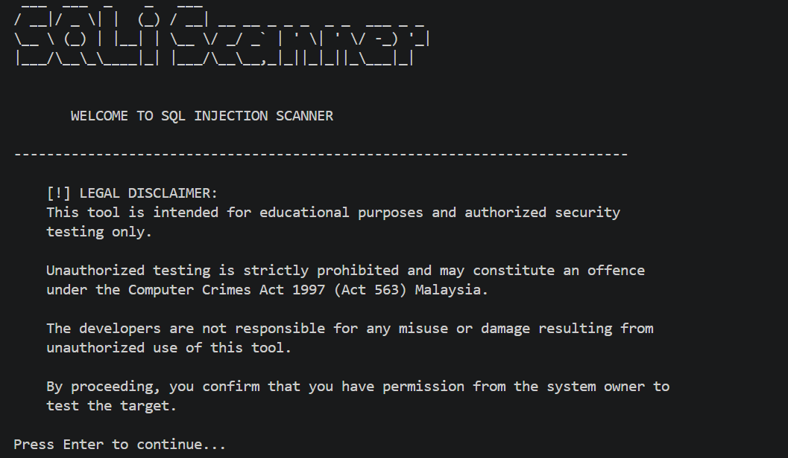
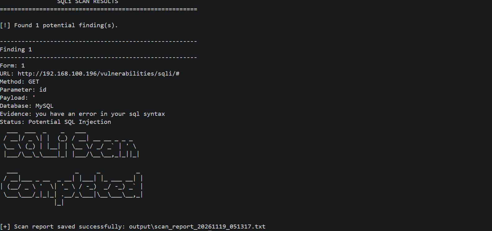

# SQLiScanner

## Description

SQLiScanner is a Python-based tool that detects potential error-based SQL Injection (SQLi) vulnerabilities in web application forms.
The scanner discovers HTML forms, tests input parameters with SQL injection payloads, and analyzes server responses for database error messages.

## Intended Users

SQLiScanner is intended for:

* Cybersecurity students learning SQL injection detection.
* Educators demonstrating web application security in controlled lab environments.
* Developers and junior penetration testers conducting authorized security assessments.

## Team Members

This project was collaboratively developed by four students from UniKL MIIT as part of the IKB31603 Ethical Hacking Assignment 1.

**GROUP 1 L01-B05**
| No. | Name | Student ID | Contribution |
|---|---|---|---|
| 1 | Muhammad Hafeez bin Mohd Radzi | 52215226085 | Scanner testing, validation, documentation and report preparation. |
| 2 | Nur Najihah Farhanah binti Hashim | 52215125111 | Core scanner development, SQL injection detection logic, payload implementation, integration and overall testing. |
| 3 | Izzat 'Irfan bin Azman | 52215124710 | HTML form discovery, input parameter identification, testing and documentation. |
| 4 | Shahril Iskandar bin Sharizan | 52215125627 | Response analysis, vulnerability verification, testing and report preparation. |

All team members contributed to the development, testing, documentation and evaluation of SQLiScanner.

## Attack Category

- **Vulnerability Class:** SQL Injection (CWE-89: Improper Neutralization of Special Elements used in an SQL Command)
- **OWASP Top 10 Mapping:** A03:2021 – Injection

## Attack Lifecycle Mapping

1. **Reconnaissance & Enumeration:** Connects to the target URL, discovers HTML forms and identifies testable input parameters.
2. **Baseline Establishment:** Sends normal form data to record the application’s expected response and help reduce false positives.
3. **Vulnerability Probing:** Tests discovered parameters using SQL injection payloads such as `'`, `"`, `')`, and `")`.
4. **Analysis & Detection:** Analyzes HTTP responses for database error signatures associated with MySQL, MSSQL and Oracle.
5. **Reporting & Safe Termination:** Displays potential findings and saves timestamped reports in the local `output/` directory. Users can interrupt scanning using `Ctrl+C`.

## Installation

1. Clone the repository:

   ```bash
   git clone https://github.com/njhhfrhnh/SQLiScanner.git
   ```

2. Navigate to the project directory:

   ```bash
   cd SQLiScanner
   ```

3. Create and activate a virtual environment (recommended):

   ```bash
   python -m venv .venv
   ```

   **Windows PowerShell:**

   ```powershell
   .venv\Scripts\Activate.ps1
   ```

   **Linux/macOS:**

   ```bash
   source .venv/bin/activate
   ```

4. Install the required dependencies:

   ```bash
   pip install -r requirements.txt
   ```

## Usage Examples

### 1. Display Help Menu
Displays available commands, options and usage instructions:

```bash
python main.py -h
```

### 2. Standard Interactive Scan

Run the scanner and follow the interactive prompts:

```bash
python main.py
```

### 3. Dry Run

Validates the target URL and scope without sending HTTP requests:

```bash
python main.py --dry-run
```

### 4. Authenticated Scan

SQLiScanner supports authenticated scanning using the `--cookie` option. For testing with DVWA, follow these steps:

1. Open DVWA in your browser and log in.
2. Navigate to **DVWA Security** and change the security level to **Low**.
3. Click **Submit** to apply the security setting.
4. Navigate to the **SQL Injection** page.
5. Press `F12` to open Developer Tools.
6. Go to Application tab (Chrome/Edge) or Storage tab (Firefox), select **Cookies** and choose your DVWA website.
7. Copy the values of `PHPSESSID` and `security` cookies.

Run SQLiScanner using the following command:

```bash
python main.py --cookie "PHPSESSID=your_session_id; security=low"
```

**Target URL:** When prompted by SQLiScanner, enter the URL of the DVWA SQL Injection page, for example:

```text
http://127.0.0.1:8080/vulnerabilities/sqli/
```

**Note:** Replace the placeholder with your own valid cookie values. Session cookies contain authentication credentials. Never share or commit them to GitHub.


## Demonstration

### 1. Legal Disclaimer and Authorization

SQLiScanner displays a legal disclaimer referencing the Computer Crimes Act 1997 (Act 563), Malaysia, and requires users to confirm their authorization before proceeding.



### 2. SQL Injection Detection

The following screenshot demonstrates SQLiScanner detecting a potential error-based SQL injection vulnerability in the DVWA testing environment.




## Rules of Engagement (RoE)

### Authorized Scope

- Testing is permitted only on localhost, isolated lab environments, or systems with explicit written authorization.
- The target hostname must be confirmed before testing begins.
- Testing outside the authorized scope is strictly prohibited.

### Testing Time Windows

- Testing must be conducted within the time window approved by the system owner.
- Testing must stop immediately if the authorized testing period expires.

### Permitted Techniques

- HTML form discovery and input parameter identification.
- Basic SQL injection payload testing.
- Detection of database error messages.
- Local report generation for vulnerability assessment.

### Prohibited Actions

- Testing systems without permission.
- Accessing, extracting, or modifying sensitive information.
- Denial-of-service attacks or destructive testing.
- Testing targets outside the approved scope.

### Emergency Stop Procedures

- Press `Ctrl+C` to activate the keyboard interrupt kill switch.
- The scanner will stop execution safely.
- Partial scan results will be saved locally when available.

## Ethical Considerations & Responsible Disclosure

SQLiScanner is developed for academic learning and authorized security testing. It includes several safeguards:

- **User Authorization:** Requires users to confirm permission before scanning.
- **Target Scope Validation:** Checks the target against the intended testing scope.
- **Safe Default Target:** Uses localhost to reduce accidental testing of external systems.
- **Limited Payloads:** Uses basic SQL syntax-breaking characters without attempting data extraction.
- **Emergency Stop:** Allows users to interrupt scanning using Ctrl+C.
- **Local Report Storage:** Saves scan results in the designated output directory.

Potential vulnerabilities should be reported privately to the affected system owner or designated security contact. Reports should include the affected URL, input parameter, error evidence and recommended remediation, such as using parameterized queries or prepared statements.

Users must avoid accessing or extracting sensitive information. Public disclosure should be avoided until the system owner has had a reasonable opportunity to address the vulnerability.

## Legal Disclaimer

**LEGAL NOTICE:** This tool is intended for educational purposes and authorized security testing only. Unauthorized testing of systems without explicit permission is strictly prohibited and may constitute an offence under the Computer Crimes Act 1997 (Act 563) Malaysia. The developers assume no responsibility or liability for any misuse or damage caused by this software.

By using this tool, users acknowledge that they are responsible for obtaining proper authorization before conducting security testing.

## Limitations

- **Error-Based Detection Only:** SQLiScanner focuses on detecting visible database error signatures. It does not currently support Boolean-based, Time-based or UNION-based SQL injection detection.
- **Limited Input Coverage:** The scanner focuses on supported HTML form input parameters and does not comprehensively test JSON payloads, HTTP headers or standalone URL query parameters.
- **Authentication Dependency:** Authenticated pages require a valid session cookie. An expired or missing cookie may cause the scanner to access a login page instead of the intended application page.
- **No Rate Limiting:** The current implementation does not provide a configurable request rate-limiting mechanism.
- **Authorization Verification:** The scanner requires user confirmation but cannot independently verify whether the user has legitimate permission to test the target.
- **Manual Verification Required:** Detected findings represent potential vulnerabilities and require manual verification to confirm their validity.

## Future Improvements

- Implement Boolean-based and Time-based SQL injection detection.
- Expand support for additional HTML input types, JSON payloads and standalone URL parameters.
- Improve detection accuracy and reduce false positives.
- Introduce configurable request rate limiting.
- Enhance authentication handling for different web application environments.
